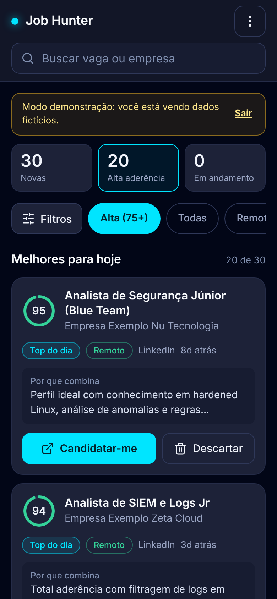
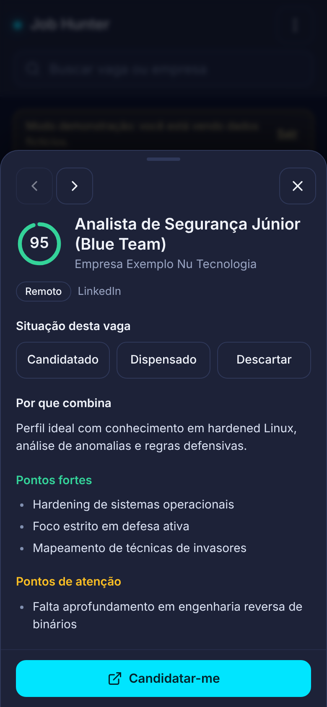
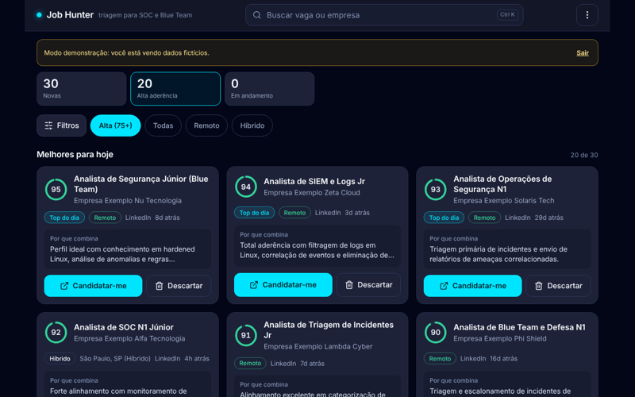

# Job Hunter

Sistema que busca vagas de cibersegurança (SOC / Blue Team) todos os dias, descarta o que não serve, pede a uma IA para dar uma nota de aderência ao meu perfil e mostra só as melhores num painel feito para o celular.


<p align="center">
  
  
</p>
<p align="center">
  
</p>

> As telas acima usam o modo demonstração, com dados fictícios.

---

## O problema que ele resolve

Procurar vaga à mão é cansativo: dezenas de sites, a mesma vaga repetida, muita coisa fora do perfil (PJ, pleno/sênior, outra cidade, salário baixo). O Job Hunter faz esse trabalho de triagem sozinho e entrega, às 7h, só o que vale a pena olhar.

## Como funciona

```
Todo dia às 7h (n8n)
   │
   ├─ Meu Perfil: cargos, regras e currículo (um único JSON)
   ├─ Uma busca por cargo (JSearch / RapidAPI, Brasil)
   ├─ Normalização: junta as buscas e remove vagas repetidas
   ├─ Triagem por regras (sem IA): PJ, senioridade, cidade, piso salarial
   ├─ Gemini: nota de 0 a 100, pontos fortes, pontos de atenção
   │       └─ uma vaga por vez, com pausa, para respeitar o limite do plano gratuito
   ├─ Supabase: grava todas as vagas avaliadas
   └─ Nota 75 ou mais: e-mail com as melhores do dia
```

Decisões que importam:

- **Regras antes da IA.** O que dá para decidir com regra (PJ, "sênior" no título, cidade, salário) é descartado sem gastar IA. A IA só avalia quem passou.
- **Uma busca por cargo.** A API lê a busca de forma literal; termos curtos e separados trazem muito mais vagas do que uma busca longa com `OR`.
- **Sem duplicar.** Cada vaga tem um `hash_dedup` único; o banco recusa repetidas, então o e-mail leva só vagas novas.
- **Corte único de 75.** O mesmo número define o e-mail das 7h, o anel verde e a lista padrão do painel.

## O painel

Feito primeiro para o celular (360 px) e depois ampliado para tablet e desktop.

- **Lista curada:** por padrão mostra só vagas com nota 75+, da melhor para a pior, sem as descartadas. "Todas" remove o corte.
- **Anel de nota:** verde (75+), âmbar (60 a 74) e rosa (abaixo disso).
- **Por que combina:** o parecer da IA aparece no próprio card, e a gaveta de detalhes mostra pontos fortes, pontos de atenção e a descrição completa.
- **Ações rápidas:** Candidatar-me (abre a vaga e oferece marcar como candidatado) e Descartar, com Desfazer.
- **Filtros:** chips para o essencial (Alta, Todas, Remoto, Híbrido) e um painel para o resto (match mínimo, fonte, período, situação, ordem).
- **Acompanhamento:** situação de cada vaga (nova, candidatado, dispensado, descartado), salva no Supabase para o dono e no navegador para visitantes.
- **Modo demonstração:** dados fictícios para quem visita o projeto.
- **Teclado:** `Ctrl+K` busca, `j`/`k` ou setas navegam, `Enter` abre, `Esc` fecha.

## Segurança

1. **Chave pública só lê.** O navegador usa apenas a chave `anon`, com Row Level Security: a tabela de vagas é de leitura.
2. **Status só do dono.** A situação de cada vaga fica em `vaga_status`, com política por usuário; só o dono logado grava.
3. **Segredos fora do código.** A `service_role`, as credenciais de e-mail e as chaves de API ficam apenas no n8n. O `.env` está no `.gitignore`.

## Dados (Supabase)

| Tabela | Para que serve |
| :--- | :--- |
| `vagas` | Vagas avaliadas, com nota, parecer, pontos fortes e de atenção |
| `vaga_status` | Situação de cada vaga para o dono (`user_id` + `vaga_id`) |
| `vaga_historico` | Histórico de mudanças de situação (criada, ainda não usada pelo painel) |
| `candidaturas`, `candidaturas_externas`, `gaps_mercado`, `perfis` | Reservadas para as próximas etapas |

Colunas de `vagas` usadas pelo painel: `id`, `hash_dedup` (único), `titulo`, `empresa`, `localizacao`, `modelo_trabalho`, `fonte`, `url_original`, `score_match`, `nivel_aderencia`, `justificativa`, `pontos_fortes`, `gaps`, `created_at` e, quando existem, `descricao_raw` e `requisitos_eliminatorios`.

## Rodando o painel localmente

Precisa de Node.js 18 ou mais.

```bash
git clone https://github.com/nandoaco/job-hunter.git
cd job-hunter
npm install
cp .env.example .env.local   # preencha com a URL e a chave anon do seu Supabase
npm run dev
```

Sem as variáveis do Supabase, o painel ainda abre no modo demonstração (menu, "Ver demonstração").

## Tecnologias

| Camada | Tecnologia |
| :--- | :--- |
| Orquestração | n8n |
| IA | Google Gemini |
| Fonte de vagas | JSearch API (RapidAPI) |
| Banco e login | Supabase (PostgreSQL, Auth, RLS) |
| Alertas | Gmail (SMTP) |
| Front | React 18, Vite, Tailwind (base) e CSS próprio |
| Hospedagem | Vercel |

## Roadmap

- [x] Triagem por regras e nota com Gemini
- [x] E-mail diário com as vagas 75+
- [x] Uma busca por cargo, sem vagas repetidas
- [x] Painel mobile-first com cards, filtros e detalhes
- [ ] Kanban de candidaturas e histórico de mudanças (`vaga_historico`)
- [ ] Alternar entre tema escuro e claro
- [ ] Agente de busca personalizado, treinado por conversa
- [ ] Carta de apresentação gerada a partir dos pontos de atenção da vaga
- [ ] Bot no Telegram (`/vagas_hoje`)
